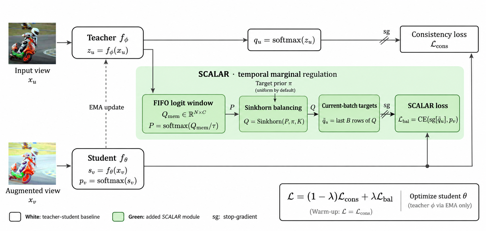

# Controlling Temporal Pseudo-Label Marginals for Stable Online Test-Time Adaptation

Code for **SCALAR** (Sinkhorn Class-Marginal Regularization).



Continual test-time adaptation (CTTA) can become unstable when pseudo-labels concentrate on a few classes over time.
SCALAR is a plug-in module for teacher–student CTTA. It keeps a short FIFO window of recent teacher logits,
applies Sinkhorn balancing to align their class marginal with a target prior (uniform by default),
and uses the balanced soft targets of the current batch as an additional loss.

## Installation

Tested with Python 3.8, PyTorch 1.13.1 and CUDA 11.7. The main dependencies are listed in `requirements.txt`.

```bash
conda create -n scalar python=3.8
conda activate scalar
pip install torch==1.13.1 torchvision==0.14.1 --extra-index-url https://download.pytorch.org/whl/cu117
pip install -r requirements.txt
```

## Data preparation

Download the corruption benchmarks:

- ImageNet-C: [Zenodo](https://zenodo.org/record/2235448)
- CIFAR-10-C: [Zenodo](https://zenodo.org/record/2535967)
- CIFAR-100-C: [Zenodo](https://zenodo.org/record/3555552)

See [DATA.md](DATA.md) for the expected folder layout under `--data_dir`.

## Models

| Dataset | Model | Checkpoint |
|---|---|---|
| ImageNet | ViT-B/16 (AugReg, IN-21k → IN-1k) | [B_16-…-res_224.npz](https://storage.googleapis.com/vit_models/augreg/B_16-i21k-300ep-lr_0.001-aug_medium1-wd_0.1-do_0.0-sd_0.0--imagenet2012-steps_20k-lr_0.01-res_224.npz) |
| CIFAR-10 | ViT-B/16 (384) | [vit_cifar10_16_384.t7](https://drive.google.com/file/d/1pAoz4Wwos74DjWPQ5d-6ntyjQkmp9FPE/view) (from ViDA) |
| CIFAR-100 | ViT-B/16 (384) | [vit_cifar100_16_384.t7](https://drive.google.com/file/d/1yRekkpkIdwX_LFsOh4Ba9ndaECnY-UC-/view) (from ViDA) |
| ImageNet (Tent) | ResNet-50 | `Standard_R50`, loaded through RobustBench |

The ViT checkpoints are passed with `--checkpoint`:

```bash
mkdir -p ckpt
wget -P ckpt https://storage.googleapis.com/vit_models/augreg/B_16-i21k-300ep-lr_0.001-aug_medium1-wd_0.1-do_0.0-sd_0.0--imagenet2012-steps_20k-lr_0.01-res_224.npz
```

Datasets and checkpoints are obtained from their original sources and are subject to their respective licenses.

## Usage

Run the scripts in `bash/` from the repository root. Paths are set with `DATA_DIR` (default `./data`) and, for `scalar.sh`, `CKPT` (default: the ViT checkpoint in `./ckpt`).

```bash
bash bash/scalar.sh            # SCALAR on ImageNet-C (ViT-B/16)
bash bash/eata_scalar.sh       # EATA with SCALAR (ViT-B/16), dynamic label skew, aggressive adaptation
bash bash/tent_cnn.sh          # Tent (ResNet-50)
```

`PRIOR_MODE` sets `--prior_mode` (default `uniform`). With `PRIOR_MODE=base`, the same script runs without SCALAR: the teacher–student baseline for `scalar.sh`, and EATA alone on the same stream for `eata_scalar.sh`.

Config values from the YAML files (corruption types, severity, batch size, optimizer) can be overridden by appending them to the command, e.g.
`DATA_DIR=/path/to/data bash bash/scalar.sh CORRUPTION.TYPE "['gaussian_noise']"`. Logs are written to `./output`.

Main options of `main.py` (set inside the scripts):

| Option | Values | Description |
|---|---|---|
| `--prior_mode` | `base`, `uniform`, `correct` | `base`: no SCALAR; `uniform`: uniform target prior; `correct`: true class prior of the stream (requires `--skew`; with `--skew none` it acts as `uniform`) |
| `--tau` | float | temperature of the logit window before Sinkhorn |
| `--window` | int | size of the FIFO logit window |
| `--skew` | `none`, `fixed`, `dynamic` | label skew of the test stream (default: `none`) |
| `--data_set` | `imagenet`, `cifar10`, `cifar100` | dataset |

## Acknowledgement

This code builds on [Tent](https://github.com/DequanWang/tent), [EATA](https://github.com/mr-eggplant/EATA),
[CoTTA](https://github.com/qinenergy/cotta), [ViDA](https://github.com/Yangsenqiao/vida)
(code base, adapted RobustBench copy and CIFAR source checkpoints) and [RobustBench](https://github.com/RobustBench/robustbench).

## License

MIT, see [LICENSE](LICENSE).
